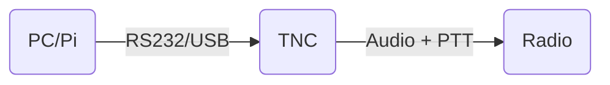
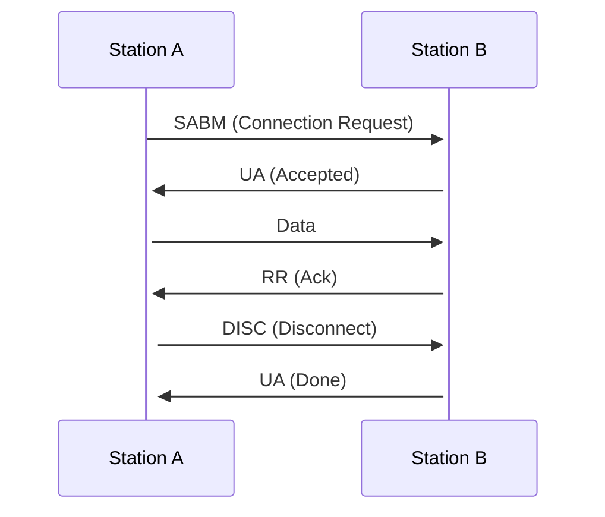

### Introduction

At the end of 2025 and beginning of 2026 I started to have a play around with some older technologies. ones that i thought might be dead and buried. One of those was packet (or AX25). It turns out that this mode is still in use and that there are quite a few nodes kicking about and there are even quite a few wikis kicking about offering help to get going. 

So what brought me to it. Well it was meshtastic really and the [Meshtastic BBS's](https://g7kse.co.uk/docs/ham-radio/meshbbs/). This was not going to be an evening project. So these notes are a sort of reminder for what I ended up doing. If something doesn't quite work I'll amend the notes to reflect the changes as I go along. Hence its work in progress.

### Summary

As my experience in packet is very limited and circa 1990 I chose to step into it slowly. Turns out it was slower than even I imagined. The rough order of play is as follows:

1. Use a low cost approach and see what I can get. I have a computer and an IC7300 for HF and an FT817 for QRP stuff that also has a data capability. This means using a sound modem instead of a hardware TNC for audio work. The goal is to connect to another node and poke about. Either with HF or VHF. If I can do this then...
2. Get hold of a hardware TNC (preferably 2) and liberate an under utilised RPi 3 to build a node. Do some local testing to connect into the node, firstly with Telnet and then with RF to check that the node can be accessed and there's nothing daft going on.
3. Get hold of an old PMR rig and build a proper node


### Progress

Lets break this down a bit so it all makes sense. These are the basic steps of where I am with things. Building knowledge as I go through. 

✅ - No cost sound modem  
✅ - Preliminary Raspberry Pi node setup (LinBPQ)  
✅ - Hardware TNC buying/building  
✅ - PMR Rig buying/setting up  
✅  - RF testing at home  
✅ - Coerce a few locals to try out the node  
✅ - Linking to other nodes  
✅  - Box it all up and set it to work  

So for getting going it's all done. My node in [GB7KSE](https://ukpacketradio.network/nodes:gb7kse) on VHF and I have a dabble every now and again on HF. VHF Details are:


  Centre	Frequency   144.925 MHz
  Polarisation        Vertical
  Power	              25 W
  Mode                AFSK AX.25 1k2bd
  Nino TNC setting    0110


These are the basic details. The node is linked to [GB7FCI](https://ukpacketradio.network/nodes:gb7fci) for [Frames](http://frames.oarc.uk) (a kind of WhatsApp style messaging system) and to [GB7DBH](https://ukpacketradio.network/nodes:gb7bdh) for mail. Both of these are via internet for now.

The bottom line is packet is alive and well. Its not at complete coverage but there is plenty to make use of even if it a mix of RF and AXIP (Internet)

<iframe style="border:1px #FFFFFF none" src="https://nodes.ukpacketradio.network/maps/packet" title="iFrame" width="100%" height="600px" scrolling="no" frameborder="no" allow="fullscreen"></iframe>


### Common setup
Before I get into a bit of detail there is a ton of stuff available. But...there is stuff all over the place, of various qualities. So getting up to speed used a load of different resources. These are all listed at the bottom of the page. 

What doi I need? Well, there needs to be something that does the RF, something that makes the right noises and something that displays the noises as something readable. A simplistic flowchart would be:



* A Terminal Node Controller (TNC) is the modem and packet controller. It does all the interfacing between the computer by building the AX25 frames, adding the CRC and leys then instructs the radio to PTT
* The PC talks to the TNC through a terminal program in either Command Mode (The TNC does all the frame building and decoding - used when there is a 'dumb' terminal at your end) or KISS Mode (The TNC just passes data to the PC and teh PC does the rest of the work). More modern stuff is KISS. The wierd thing about a TNC is that it can be either a physical thing (Hardware) or a bit of Software (Software TNC)
* The packet is passed to the radio at either 300 baud for HF, 1200 baud for VHF or 9600 baud for UHF as Audio Frequency Shift Keying (AFSK)

One user can talk to another user either directly, through another node or through a repeater, called a digipeater. The diagram below shows Station A wanting to connect to Station B but needs to go through 2 other nodes to get there. You can substitute node with digipeater if you want (the difference being the digipeater is only there to digitally repeat the data. A node is another station that might have a user at the other end). In either instance the network gives the boost.

```mermaid
flowchart LR 
  A (Station A) -> B (nearby node)
  B (nearby mode) -> C (another node)
  C (another node) -> D (Station B)
```

All this assumes there is no internet connection, which there generally is nowadays. For now we'll keep it all RF, but there is an internet component. The 'QSO' follows a set routine. There is a conversation between nodes



Like all methods there are nuances on HF there is and additional component called IL2P that adds forward error correction. You can find these on 40m but check on the map and look at the HF stations in particular. Slow but more robust than you might think.


  *A Question* Do you want to use 
  1. HF?
  2. VHF?
  3. UHF?


I started out with HF because I have an HF rig that is capable of doing the work. I also didn't have a hardware TNC. I also use a Linux computer (Ubuntu). My notes reflect that pathway. Later I bought a couple of Nino TNC's and a old PMR radio because I wanted to set up my own node. More on that later.

#### Low entry bar - HF (40m) with a softwatre TNC

There are a couple of things needed for this. One is the sound modem itself, the other it the way we need to interact with it. After a bit of reading up on [Hibby's Guide](https://guide.hibbian.org/) and the [Online Amateur Radio Club (OARC) Wiki](https://wiki.oarc.uk/packet) I plumped for [QtSoundModem](https://www.cantab.net/users/john.wiseman/Documents/QtSoundModem.html) and [QtTermTCP](https://www.cantab.net/users/john.wiseman/Documents/QtTermTCP.html). They seem to be fairly common and developed by teh same person who developed [LinBPQ](https://www.cantab.net/users/john.wiseman/Documents/BPQ32.html) so I assumed it's all going to be straightforward. Ha!

My recommendation after a bit of hit and miss is to install the [Hibby Repo](https://guide.hibbian.org/repo/). Yes, this is for Linux and yes there are other ways but I found this to be the easiest (I also used this for the LinBPQ build later). For those that like to skip the code is...

```
cd /tmp
wget https://guide.hibbian.org/static/files/setup.sh
chmod +x /tmp/setup.sh
sudo bash /tmp/setup.sh
```

Install the software in the usual way 
```
sudo apt install qtsoundmodem qttermtcp
```


Ok, so everything is installed and all it needs it to be configured. Again, the Hibby guide is excellent. But, for IC7300 users like me I found it a right pain to get the rig to TX so the advice is to make offerings. It is a right royal pain to make it consistent. But here we go:

Under the **Connectors** settings

| Function                        	|    Value   	|
|---------------------------------	|:----------:	|
| ACC/USB Output Select           	|     AF     	|
| ACC/USB AF Output Level         	|     60%    	|
| ACC/USB AF SQL                  	| Off (Open) 	|
| ACC/USB AF Beep/Speech...Output 	|     Off    	|
| ACC/USB IF Output Level         	|     50%    	|
| ACC Mod Level                   	|     50%    	|
| USB Mod Level                   	|     50%    	|
| Data Off Mod                    	|   MIC/ACC  	|
| Data Mod                        	|     USB    	|

Under **CI-V Transceive** settings

| Function                            	|          Value         	|
|-------------------------------------	|:----------------------:	|
| CI-V Baud Rate                      	|          Auto          	|
| CI-V Address                        	|           94h          	|
| CI-V Transceive                     	|           On           	|
| USB USB - REMOTE Transceive Address 	|           00h          	|
| CI-V Output (for ANT)               	|           Off          	|
| CI-V USB Port                       	| Unlink remote [REMOTE] 	|
| CI-V USB Baud Rate                  	|          Auto          	|
| CI-V USB Echo Back                  	|           OFF          	|

Under **USB SEND/KEYING** settings

| Function                        	| Value 	|
|---------------------------------	|:-----:	|
| USB SEND                        	|  RTS  	|
| USB Keying (CW)                 	|  Off  	|
| USB Keying (RTTY)               	|  DTR  	|
| Inhibit Timer at USB Connection 	|  Off  	|

Even after setting this up my Ubuntu machine still had moments where it refused to TX. This is definitely not a favourite feature of the IC7300. It was outstanding frustrating and there is very little to explain why and how to prevent it being a muppet. Ok, so gripe over. The settings on the soundmodem were as per Hibby's guide. But here are modems that worked consistently for me. Set the dial frequency to 7.049.45 USB (DATA) and with modems set as per the image below


After a while you should see data packets being decoded. Bear in mind that I live in the north west of England (IO84) the HF stations near you might be slightly different so a bit of trial and error might be needed.


Now to connect to a station, Hibby's guide is helpful here, but to be really specific I used the AGW Connection to EI5IYB-1 on ``` Port 2 Soundcard Ch B ``` and after a few seconds of to and fro I go a response from EI5IYB. Be patient, its 300 baud so isn't going to be quick and I got quite a few disconnections at first, which I put down to the poor HF propagation at the time


Once in you can use the ```?``` command to find out more or make use of the [LinBPQ Cheat Sheet](https://ham.packet-radio.net/packet/bpq32/bpq32-guide/bpq-user-and-sysop-commands.pdf). You can start poking around and enjoying packet radio. Don't be surprised if the connection drops on HF. It seems to be a common occurrence for me, just reconnect and go back


#### Setting up a node (LinBPQ)

This could have been easy, but wasn't. First I flashed a fresh version of Raspbian Lite on my Pi and tried to install everything via the same Hibby repo as above.  

Not happy  

Actually read the instructions this time and realised it didn't like that OS, so changed it to the desktop version that was compatible. It all installed corrected but none of the changes to the configuration file seemed to save and so I was basically locked out  

The 3rd attempt noticed some amended information on a wiki and used Raspbian Trixie Lite with a command line install, without any config file builder. Just used nano to update the config file and all is well. I have a working LinBPQ setup. But this is not the end of it. The config file needs a bit of work. After a while I came across some example config files that worked. These are on the [Packetradio.net BPQ32 pages](https://packet-radio.net/bpq32/). There seems to be no complete.  


I am very sure I'll need to come back to this and explain teh parameters a bit better and the settings I have chosen. I will do this once I have confirmed all is well.


So far testing via telnet seems to be working nicely


Seeing this give me some confidence that LinBPQ is setup correctly for basic operations. We'll get stuck into linking and AXIP at some point I expect, it's here that is starts to get more complicated and my understanding goes through thr floor at the moment. I suspect I'll be asking for help!

#### Hardware TNC buying/building

I ordered a Nino TNC kit from Hamserve for £35 and had it knocked up in an hour or so. Despite checking things I still managed to solder one part in wrong, so it took me a while to de-solder it without killing the board. But after a minor mix up it all works fine. 

The [build instructions](https://tarpn.net/t/nino-tnc/n9600a/n9600a4r3/n9600a4r3-assembly.html) at TAPR are very good, so no need to go over that, as were the setting to work instructions. For completeness the [operator instructions](https://tarpn.net/t/nino-tnc/n9600a/n9600a_operation.html) are also linked here.

I've managed to source an older PK-88 that may or may not work for testing with local stuff. This should arrive at some point and once I have enough hardware and confidence in the LinBPQ setup (it seems to be ok on Telnet) then I'll conduct some more thorough stuff.

#### PMR Rig buying/setting up

After a load of looking I settled on a rather ratty Tait T8110 of eBay. There is a lot of useful information on transceivers on the [OARC Wiki](https://wiki.oarc.uk/packet:transceivers). So it was just a matter of finding a suitably cheap transceiver and pressing the 'buy' button. Once it arrived I used the additional power cable and programming cable to do its thing. Then give it a local test to check there was RF coming out. All successful.

Some useful resources for programming are also on the [wiki](https://wiki.oarc.uk/radios:tait_tm8100) that includes a basic packet setup that works. I did have a bit of a panic as the unit wouldn't change channels when it originally arrived, but wiping the memory and uploading the boilerplate from OARC worked.

### Connecting to others
So far everything is still fairly retro. To conclude this some of the more useful terminal commands are below. There is a much longer [Cheat Sheet](https://cheatography.com/gcremerius/cheat-sheets/bpq-user-commands/) available but here are some common ones

*connect* Connect to a node or station
*nodes* Nodes known to this node
*routes* Neighbours the node can reach
*mheard* Stations heard per port
*port* Configured ports
*users* Who is using the node
*links* Cureent AX25 sessions
*info* Sysops node description
*bbs* Enter mailbox (contains mail to user or bulletins)
*chat* Enter chat
*bye* diconnect froom the node
*?* help

all the commands can be abbreviated to a sinlge upper or lower case letter, it doesn't matter

### Modern advances
Internet linking is a clear modern addition, but also browser based interaction is possible through [Frames](static/img/frames.png#centre). This is an emerging application from [OARC](https://wiki.oarc.uk/packet:frames). It runs in your browser and is more like a modern messaging system and users of Meshtastic and Meshcore will find that the barrier to enrty and use is now a lot lower. 

There are also Android and iOS apps which take packet out of the termical and into your pocket. These developments are well worth keeping an eye on

### Useful references
By no means and exhaustive list but links to things I found useful to read up on. There are quite a few videos floating about, some of them sort of conflict or overlap with others but in general The Modern Ham and PE1RRR ones were the ones I found most useful. 

##### General stuff
[Hibby's Guide - Really handy and mostly complete](https://guide.hibbian.org/)  
[OARC Packet Wiki](https://wiki.oarc.uk/packet)  
[Packet Node Map - BPQ nodes from what I can tell](https://nodes.ukpacketradio.network/packet-network-map.html?rfonly=1)  
[The Modern Ham - A good general resource](https://themodernham.com/packet-radio-101-the-ultimate-guide/) 
[PE1RRR's guides and general information as well as some detailed stuff](https://eindhoven.space/radio-experiments/packet-radio/)   
[LinBPQ cheat Sheet - Handy for commands](https://ham.packet-radio.net/packet/bpq32/bpq32-guide/bpq-user-and-sysop-commands.pdf)  


##### Really specific stuff
[Farpn Wiki LinBPQ config](https://wiki.farpn.net/tutorial-packet-on-pi)  
[OARC BPQ for beginners](https://wiki.oarc.uk/member-projects:m0jqq_-_bpq_for_beginners)  
[Packetradio.net BPQ config examples](https://packet-radio.net/bpq32/)  
[Nino TNC - Information for building and operating](https://tarpn.net/t/nino-tnc/nino-tnc.html)  
[Nino TNC UK supply through Hamserve](https://www.hamserve.uk/tarpn-ninotnc-n9600a/)  

### Map of UK packet nodes (including APRS)

---
<iframe style="width: 100%; height: 900px; border: 0;" allowfullscreen allow="geolocation" src="//umap.openstreetmap.fr/en/map/packet-nodes_1340087?scaleControl=false&miniMap=false&scrollWheelZoom=false&zoomControl=true&editMode=disabled&moreControl=true&searchControl=true&tilelayersControl=null&embedControl=null&datalayersControl=true&onLoadPanel=none&captionBar=false&captionMenus=true"></iframe><p><a href="//umap.openstreetmap.fr/en/map/packet-nodes_1340087?scaleControl=false&miniMap=false&scrollWheelZoom=true&zoomControl=true&editMode=disabled&moreControl=true&searchControl=true&tilelayersControl=null&embedControl=null&datalayersControl=true&onLoadPanel=none&captionBar=false&captionMenus=true">See full screen</a></p>
---
